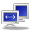
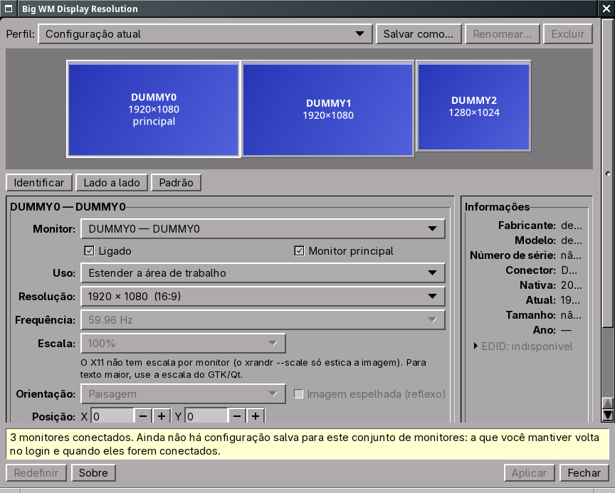
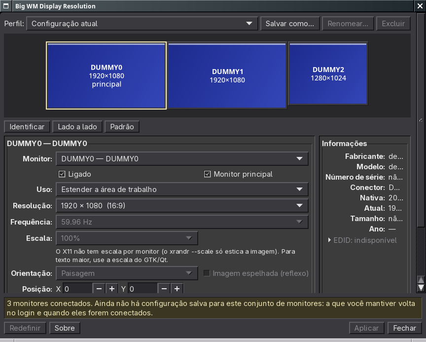
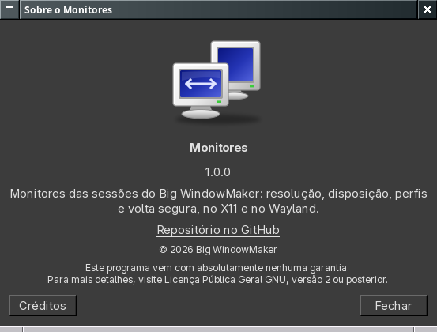

<p align="center">
  
</p>

<h1 align="center">Big WM Display Resolution</h1>

<p align="center">
  <a href="https://github.com/big-windowmaker/big-wm-display-resolution/actions/workflows/ci.yml"></a>
  
  
  
</p>

<p align="center">
  <b>Os monitores do Big WindowMaker: resolução, disposição, perfis e uma volta segura.</b><br>
  X11 (Window Maker, XRandR) e Wayland (wlmaker, <code>wlr-output-management</code>).
</p>

<p align="center">
  <a href="#recursos">Recursos</a> ·
  <a href="#capturas">Capturas</a> ·
  <a href="#instalar">Instalar</a> ·
  <a href="#usar">Usar</a> ·
  <a href="#desenvolvimento">Desenvolvimento</a> ·
  <a href="#contribuir">Contribuir</a> ·
  <a href="#créditos">Créditos</a> ·
  <a href="#in-english">English</a>
</p>

<p align="center">
  
</p>

## Recursos

No menu do Big WindowMaker: **Configurações > Monitores**.

- Monitores em escala e na posição real; arrastar com encaixe, coordenadas
  exatas, Identificar.
- Resolução e frequência só dos modos anunciados (a nativa marcada), escala
  (Wayland), orientação e reflexo, ligar/desligar, estender/espelhar,
  monitor principal (X11).
- Informações do EDID; identidade do monitor = fabricante + modelo + serial.
- VRR e HDR só como existem de verdade (a janela explica o porquê).
- Aplicar sempre pergunta "Manter estas configurações?" e volta sozinho em
  15 s — por um processo vigia separado, mesmo se a janela travar.
- Perfis em `~/.config/big-wm/display-resolution/profiles.json` (com
  `profiles.json.bak`), aplicados no login e quando o conjunto de monitores
  muda (eventos do XRandR / do compositor, sem polling). Um conjunto que é
  parte de um perfil (os monitores voltando um de cada vez) usa os lugares
  desse perfil; a janela aberta acompanha a chegada e a saída de monitores.

## Capturas

Capturas de 12/11/2026: Window Maker com três monitores (driver `dummy` do
Xorg, o mesmo do laboratório de testes).

| | |
|---|---|
|  |  |
| Modo escuro (acompanha o tema da sessão) | Sobre, com os mantenedores e os agradecimentos em Créditos |

## Usar

    big-wm-display-resolution              a janela
    big-wm-display-resolution --restore    aplica o perfil do conjunto conectado
    big-wm-display-resolution --watch      vigia de hotplug (autostart)
    big-wm-display-resolution --show       o que está conectado e o perfil que vale
    big-wm-display-resolution --profiles   lista os perfis

Documentação completa:
[docs/display-resolution.md](https://github.com/big-windowmaker/big-wm/blob/main/docs/display-resolution.md)
no repositório big-wm.

## Instalar

No Big WindowMaker ele já vem instalado (dependência do `big-wm-session`).
Para compilar o pacote a partir deste repositório:

```sh
cd pkgbuild
BWMDR_SOURCE="git+file://$PWD/.." makepkg -si
```

Remover: `sudo pacman -R big-wm-display-resolution` (os perfis ficam em
`~/.config/big-wm/display-resolution/`).

## Desenvolvimento

```sh
make            # o helper (wayland-client, Xlib/XRandR)
make check      # pytest: modelo, perfis, reversão, migração, X11, tradução
make po         # atualiza o .pot e o pt_BR.po (po/make-pt_BR.py)
make install DESTDIR=/tmp/destino
```

Requisitos: Python 3 com PyGObject e pycairo, GTK 3, `wayland`, `libx11`,
`libxrandr`, `xorg-xrandr`, `hwdata`; para os testes, `python-pytest`.
Problemas e sugestões: [issues](https://github.com/big-windowmaker/big-wm-display-resolution/issues).

## Contribuir

- Problemas: [issues](https://github.com/big-windowmaker/big-wm-display-resolution/issues),
  com a sessão (X11 ou Wayland) e a saída de `big-wm-display-resolution --show`.
- Código: *pull request* com `make check` passando; leia o
  [guia de contribuição](https://github.com/big-windowmaker/.github/blob/main/CONTRIBUTING.md).
- Testes com monitores de verdade sem hardware: `tests/lab/xdummy.sh`
  (Xorg sem root com o driver `dummy`, 16 saídas).

## Créditos

**Mantenedores do Big WindowMaker:** Rafael Ruscher <rruscher@gmail.com> e
Barnabé Di Kartola <barnabedikartola@gmail.com>.

**Agradecimentos especiais:** Alfredo Kojima (pelo
[Window Maker](https://www.windowmaker.org/)), Philipp Kaeser (pelo
[wlmaker](https://github.com/phkaeser/wlmaker)), Bruno Gonçalves (pelo
[BigLinux](https://www.biglinux.com.br/)) e Tales A. Mendonça (pela
BigCommunity).

Os nomes dos fabricantes vêm do `pnp.ids` do pacote `hwdata`.

## Licença

GPL-2.0-or-later — ver [LICENSE](LICENSE).

## In English

**Big WM Display Resolution** is the monitor manager of Big WindowMaker, for
the X11 (Window Maker, XRandR) and Wayland (wlmaker, wlr-output-management)
sessions: monitors drawn to scale, only the modes the monitor announces,
profiles applied at login and on hotplug (events, no polling), and every
change asks "Keep these settings?" and reverts by itself after 15 s, from a
separate watchdog process. Build with `make && make check`; package with
`pkgbuild/PKGBUILD`. Maintainers: Rafael Ruscher and Barnabé Di Kartola.
License: GPL-2.0-or-later.
