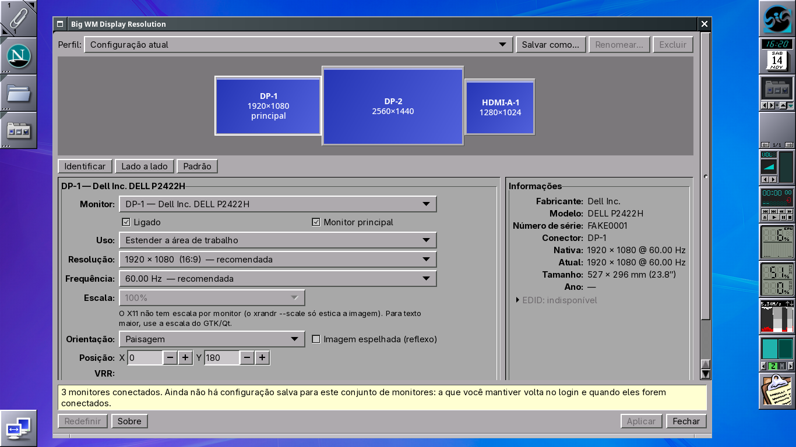
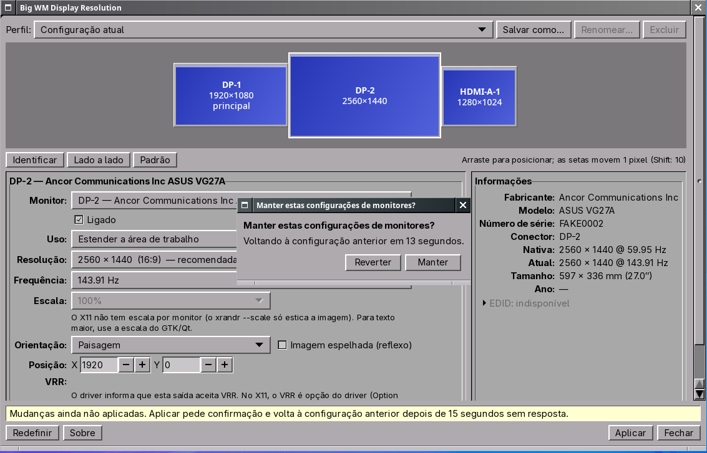
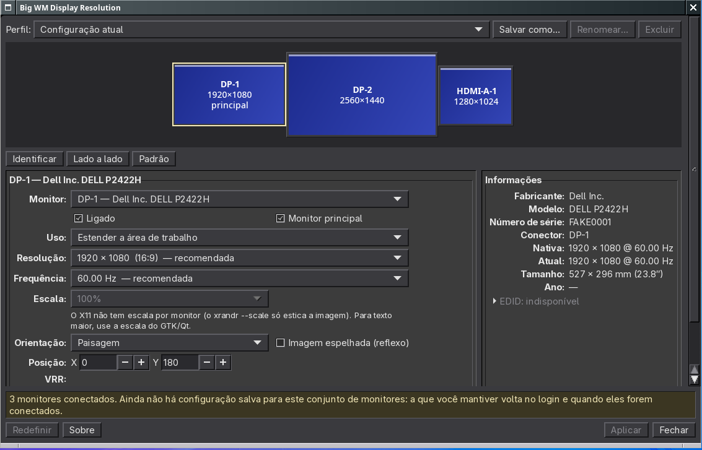
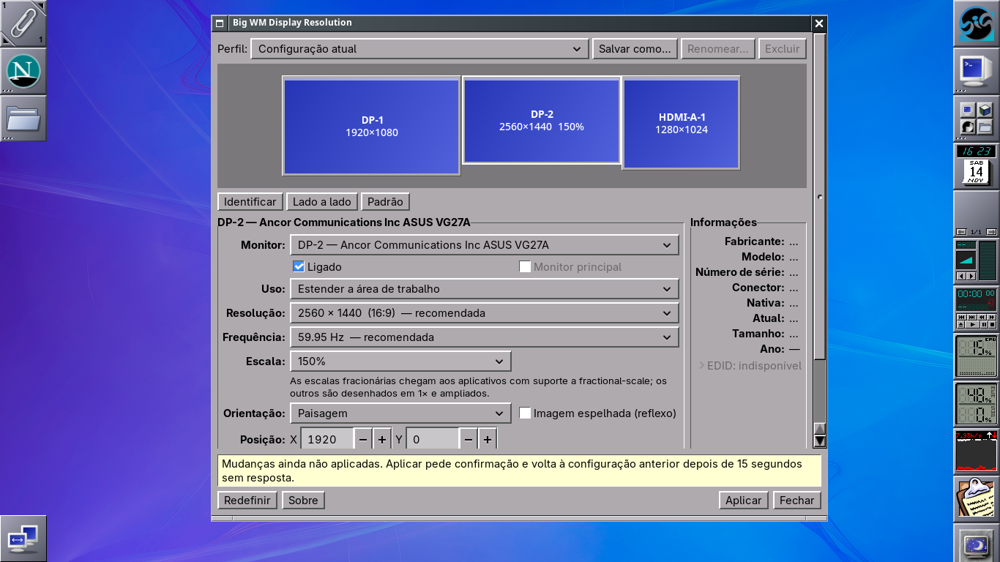
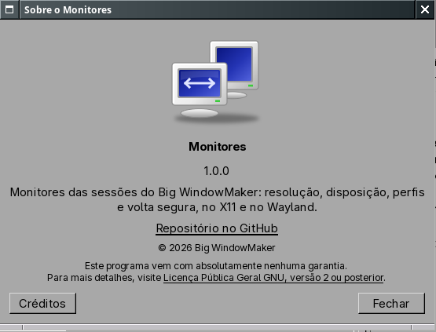

<p align="center">
  
</p>

<h1 align="center">Big WM Display Resolution</h1>

<p align="center">
  <a href="https://github.com/big-windowmaker/big-wm-display-resolution/actions/workflows/ci.yml"></a>
  
  
  
</p>

<p align="center">
  <b>Os monitores do Big WindowMaker: resolução, disposição, perfis e uma volta segura.</b><br>
  X11 (Window Maker, XRandR) e Wayland (wlmaker, <code>wlr-output-management</code>).
</p>

<p align="center">
  
</p>
<p align="center"><sub>A janela no X11, com três monitores. No menu do Big WindowMaker: <b>Configurações &gt; Monitores</b>.</sub></p>

## Sumário

- [Recursos](#recursos)
- [Capturas](#capturas)
- [X11 e Wayland](#x11-e-wayland)
- [Instalar](#instalar)
- [Usar](#usar) · [Perfis](#perfis)
- [Desenvolvimento](#desenvolvimento)
- [Contribuir](#contribuir) · [Créditos](#créditos) · [Licença](#licença) · [English](#in-english)

## Recursos

| | |
|---|---|
| **Disposição em escala** | Monitores desenhados em escala e na posição real; arrastar com encaixe, setas movem 1 pixel (Shift: 10), coordenadas exatas, **Lado a lado**, **Padrão** e **Identificar** (o nome em cada tela). A janela avisa vãos e sobreposições antes de aplicar. |
| **Só modos de verdade** | Resolução e frequência só dos modos que o monitor anuncia, com a nativa marcada como recomendada; orientação e reflexo; ligar e desligar; estender ou espelhar. |
| **Informações do monitor** | Fabricante (pelo `pnp.ids` do `hwdata`), modelo, número de série, conector, modo nativo e atual, tamanho físico e o EDID. A identidade do monitor é fabricante + modelo + serial, não o conector. |
| **VRR e HDR honestos** | Aparecem como existem de verdade, e a janela explica o porquê quando não dá para mudar. |
| **Volta segura** | Aplicar sempre pergunta "Manter estas configurações de monitores?" e volta sozinho em 15 s, por um processo vigia separado, mesmo se a janela travar. |
| **Perfis** | Um perfil por conjunto de monitores, aplicado no login e quando o conjunto muda, por eventos (XRandR ou compositor), sem polling. Quando os monitores voltam um de cada vez, o conjunto parcial usa os lugares do perfil, e a janela aberta acompanha. |
| **Migração** | Lê, sem executar, os scripts do ARandR (`~/.screenlayout/*.sh`) e o `OutputState.plist` do wlmaker. |
| **No estilo da sessão** | Acompanha o modo claro ou escuro do Big WindowMaker; barras de rolagem do WINGs; a roda do mouse não muda valores por acidente. |

## Capturas

Capturas de 14/11/2026, num servidor X próprio (Xvfb) com a sessão do Big
WindowMaker. Os três monitores são de teste (o backend `BIGWM_DISPLAY_FAKE`,
um arquivo JSON), então nenhuma tela de verdade mudou.

| | |
|---|---|
|  |  |
| Aplicar pede confirmação e volta sozinho em 15 s | Modo escuro (acompanha o tema da sessão) |
|  |  |
| Wayland (wlmaker): escala por monitor, sem monitor principal | Sobre, com os mantenedores e os agradecimentos em Créditos |

## X11 e Wayland

A janela é a mesma; muda o backend, escolhido pela sessão.

| | X11 (Window Maker) | Wayland (wlmaker) |
|---|---|---|
| Como aplica | `xrandr` | `big-wm-display-helper` (`wlr-output-management-unstable-v1`); nunca `xrandr` no XWayland |
| Escala por monitor | — (o `xrandr --scale` só estica a imagem; use a escala do GTK/Qt) | 100% a 300%; as fracionárias chegam aos aplicativos com `fractional-scale` |
| Monitor principal | ✅ | — (o protocolo não tem) |
| VRR | só informa: é opção do driver (`Option "VariableRefresh"`) | liga e desliga, quando o compositor oferece (gerenciador versão 4) |
| Espelhar, orientação, reflexo, ligar e desligar | ✅ | ✅ |
| Eventos de conexão (vigia) | RandR (`RROutputChangeNotify`) | eventos do compositor |
| Identificar | o nome em cada monitor | o mesmo; com `gtk-layer-shell` (opcional), por cima de tudo |
| Migração | scripts do ARandR | `OutputState.plist` do wlmaker |

## Instalar

No Big WindowMaker ele já vem instalado (dependência do
`big-wm-session`). Para compilar o pacote a partir deste
repositório (Arch/Manjaro):

```sh
cd pkgbuild
BWMDR_SOURCE="git+file://$PWD/.." makepkg -si
```

| Pacote | Para quê |
|---|---|
| `python`, `python-gobject`, `python-cairo`, `gtk3`, `glib2`, `pango` | a janela |
| `wayland`, `libx11`, `libxrandr`, `glibc` | o `big-wm-display-helper` (C) |
| `xorg-xrandr` | backend X11 |
| `hwdata` | nomes dos fabricantes (`pnp.ids`), os mesmos do wlroots |
| `util-linux` | `logger` (registro no diário) |
| `hicolor-icon-theme` | ícone |
| `gtk-layer-shell` (opcional) | Identificar no Wayland |
| `arandr`, `wdisplays` (opcionais) | alternativas no X11 e no Wayland |

O `pkgver` é a data da compilação (`aa.mm.dd`) e o `pkgrel` a hora, como no
big-wm; a versão do programa (1.0.0) aparece no Sobre e em `--version`. O
CI publica o pacote como artefato para a ISO (`build-iso`).

Remover: `sudo pacman -R big-wm-display-resolution` (os perfis ficam em
`~/.config/big-wm/display-resolution/`).

## Usar

| Comando | O que faz |
|---|---|
| `big-wm-display-resolution` | abre a janela (ou traz a que já está aberta) |
| `big-wm-display-resolution --restore` | no login: aplica o perfil do conjunto conectado, sem janela |
| `big-wm-display-resolution --watch` | vigia de conexão de monitores (autostart nas duas sessões) |
| `big-wm-display-resolution --hotplug` | o mesmo do `--restore`, chamado pelo vigia |
| `big-wm-display-resolution --show` | o que está conectado e o perfil que vale |
| `big-wm-display-resolution --profiles` | lista os perfis |
| `big-wm-display-resolution --apply-profile NOME` | aplica um perfil, sem confirmação |
| `big-wm-display-resolution --version` | a versão |

```console
$ big-wm-display-resolution --show
sessão: wayland
DP-1      dell inc.|dell p2422h|…     DP-1: 1920x1080@60.00 em 0,180
DP-2      ancor communications inc|…  DP-2: 2560x1440@59.95 em 1920,0
perfil: nenhum para este conjunto de monitores
```

### Perfis

- Ficam em `~/.config/big-wm/display-resolution/profiles.json` (JSON
  legível), com a última versão boa em `profiles.json.bak`, usada se o
  principal quebrar.
- **Salvar como…**, **Renomear…** e **Excluir** na linha **Perfil**; o
  perfil mantido depois de "Manter" volta no login e quando aquele conjunto
  de monitores é conectado.
- Na sessão X11, o `startbigwm` chama o `big-wm-monitors --restore` antes do
  Window Maker, para ele já começar com as telas no lugar.

Documentação completa:
[docs/display-resolution.md](https://github.com/big-windowmaker/big-wm/blob/main/docs/display-resolution.md)
no repositório big-wm.

## Desenvolvimento

```sh
make            # o helper (wayland-client, Xlib/XRandR)
make check      # pytest: modelo, perfis, reversão, migração, X11, rolagem e tradução
make po         # atualiza o .pot e o pt_BR.po (po/make-pt_BR.py)
make install DESTDIR=/tmp/destino
```

Para compilar: `gcc`, `pkgconf`, `wayland` (`wayland-scanner`), `libx11`,
`libxrandr` e `gettext`; para os testes, `python-pytest`. O `make check`
roda sem tela (`DISPLAY` e `WAYLAND_DISPLAY` desligados).

| Variável | Para quê |
|---|---|
| `BIGWM_DISPLAY_FAKE=arquivo.json` | backend de teste: monitores descritos num JSON (formato do `wl-dump`); aplicar só grava o arquivo |
| `BIGWM_DISPLAY_FAKE_SESSION=x11\|wayland` | qual sessão o backend de teste imita |
| `BIGWM_DISPLAY_HELPER`, `BIGWM_DISPLAY_LOCALEDIR`, `BIGWM_DISPLAY_DATADIR` | rodar a cópia do repositório sem instalar |

Laboratórios (num X próprio, **nunca** na sessão de verdade):

- `tests/lab/xdummy.sh`: Xorg sem root com o driver `dummy` (16 saídas
  RandR reais, sem tocar no hardware);
- `tests/lab/i18n_lab.py` e `tests/lab/scroll_lab.py`: capturas da tradução
  e conferência da rolagem com a janela de verdade.

## Contribuir

- Problemas: [issues](https://github.com/big-windowmaker/big-wm-display-resolution/issues),
  com a sessão (X11 ou Wayland) e a saída de `big-wm-display-resolution --show`.
- Código: *pull request* com `make check` passando; leia o
  [guia de contribuição](https://github.com/big-windowmaker/.github/blob/main/CONTRIBUTING.md).
- Tradução: `po/pt_BR.po`, com o glossário em `po/glossary/pt_BR.tsv`
  (`make po` regenera; o teste confere que o `.pot` está em dia).

## Créditos

**Mantenedores do Big WindowMaker:** Rafael Ruscher <rruscher@gmail.com> e
Barnabé Di Kartola <barnabedikartola@gmail.com>.

**Agradecimentos especiais:** Alfredo Kojima (pelo
[Window Maker](https://www.windowmaker.org/)), Philipp Kaeser (pelo
[wlmaker](https://github.com/phkaeser/wlmaker)), Bruno Gonçalves (pelo
[BigLinux](https://www.biglinux.com.br/)) e Tales A. Mendonça (pela
BigCommunity).

Os nomes dos fabricantes vêm do `pnp.ids` do pacote `hwdata`.

## Licença

GPL-2.0-or-later — ver [LICENSE](LICENSE).

## In English

**Big WM Display Resolution** is the monitor manager of Big WindowMaker, for
the X11 (Window Maker, XRandR) and Wayland (wlmaker, wlr-output-management)
sessions: monitors drawn to scale, only the modes the monitor announces,
profiles applied at login and on hotplug (events, no polling), and every
change asks "Keep these settings?" and reverts by itself after 15 s, from a
separate watchdog process. Build with `make && make check`; package with
`pkgbuild/PKGBUILD`. Maintainers: Rafael Ruscher and Barnabé Di Kartola.
License: GPL-2.0-or-later.
